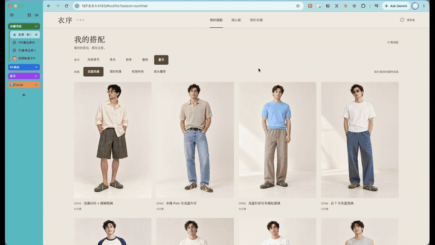
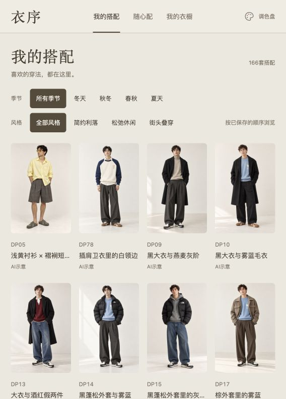
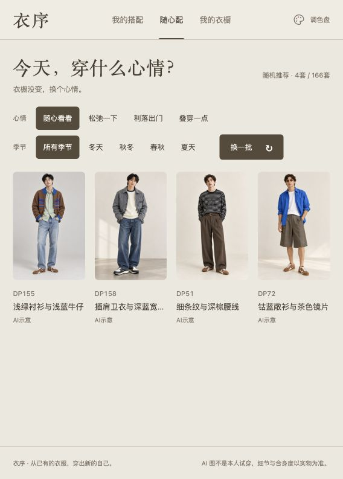
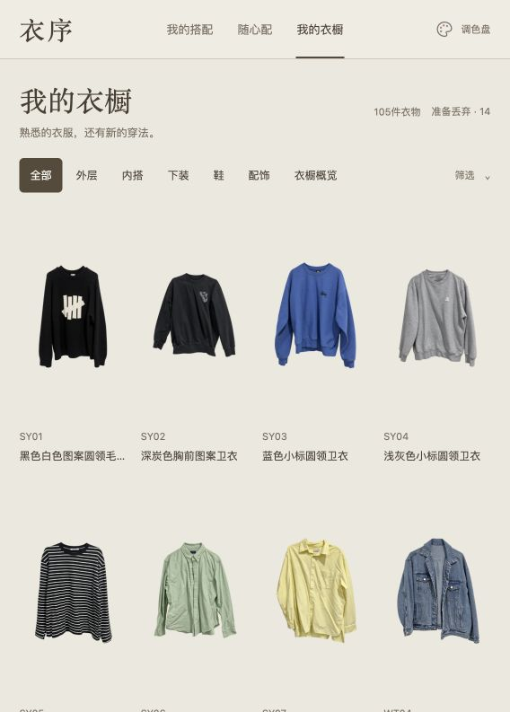
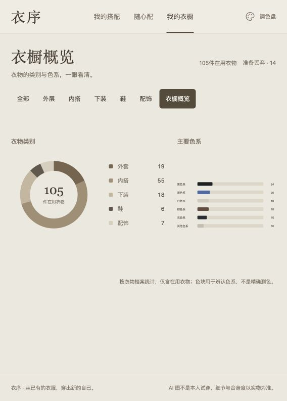

# 衣序 Yixu

### 衣服不少，出门还是那几件。

我把自己衣柜里的衣服整理成了一个小网站，让 AI 帮我想搭配，再把自己愿意穿的留下来。出门前，选个季节、换几套看看；想买衣服时，先看看已有的衣服还能怎么穿。

[看完整演示](#先看完整演示) · [看看它能做什么](#自己的衣服可以有多少种穿法) · [建立自己的衣橱](#开始使用) · [English](https://github.com/hlckl123456/yixu-wardrobe-en)

## 先看完整演示

https://github.com/user-attachments/assets/c71a9504-50dc-487f-9cb6-c3941e5765c5

**3 分 32 秒完整演示，带中文讲解，可以直接在这里播放。** 从整理自己的衣服，到挑选搭配、随心换批，再到买衣服前让 AI 帮忙看看。页面内使用压缩版，也可以[下载原画质完整版](https://github.com/hlckl123456/yixu-wardrobe-zh/releases/download/demo-2026-10-22/yixu-demo-zh.mp4)。

> 下方截图来自我的真实衣橱，拍摄时有 105 件在用衣物、166 套已保存搭配。衣物照片对应我已有的衣服；人物上身图是 AI 搭配示意，不是我的试穿照片。公开源码从空衣橱开始，展示用截图和视频不等于下载后自带的数据。

<details>
<summary>先看 8 秒静音片段：随心配怎么换一批</summary>

[](https://github.com/hlckl123456/yixu-wardrobe-zh/releases/download/demo-2026-10-22/yixu-demo-zh.mp4)

</details>

## 自己的衣服，可以有多少种穿法

### 我的搭配：留下“这套，我想穿”的

AI 提了很多组合，但我不会全部留下。裤子太正式就换，颜色不协调就改，整套不喜欢就移走。确认过的搭配按保存顺序放在一起，点季节和风格就能筛选。



点开一套，可以看穿法说明和用到的衣物；点开其中一件衣服，又能找到使用它的其他搭配。图片里的组合能对应回自己的衣橱。

### 随心配：只想决定今天穿什么

不用先安排一整周。选“松弛一下”“利落出门”或“叠穿一点”，再选季节，一次看最多四套。不喜欢就换一批，直到看到今天想穿的。



第一批就是随机选的；继续换批会优先展示本轮没看过的搭配。它从**你已经保存、符合条件的搭配**里选，不会每点一次就重新花钱调用 AI。没有符合条件的搭配时，会保留空状态，方便你知道还需要补什么。

### 我的衣橱：让买过的衣服更容易被看见

上装、下装、鞋和配饰都可以直接浏览。桌面宽屏一行四件，文字尽量少，让衣服先被看到。



我尤其喜欢按搭配引用筛选的功能。哪些衣服还没用到，哪些只出现在一两套搭配里，一眼就能找到。可以让 AI 从这些衣服开始想新搭配，也可以重新考虑是否要继续保留。

这里统计的是**保存的搭配引用次数**，不是实际穿着次数；没有用到，不会被自动判定为应该丢弃。

## 还有一些每天用得上的小功能

| 功能 | 可以怎么用 |
| --- | --- |
| 衣橱概览 | 看衣物类别和色系分布，买之前先知道自己已经有什么。 |
| 调色盘 | 一键切换暖米、粉、蓝、绿四种页面配色，衣橱内容不变。 |
| 准备丢弃 | 把暂时不想继续搭配的衣服放到次级入口，保留编号、记录和历史关联。 |
| 看大图与穿法 | 放大检查搭配，查看下摆、叠穿等说明，再回到真实衣物确认。 |
| 待购搭配 | 把还没买的单品明确标出来，和自己已经拥有的衣服区分开。 |



## AI 负责提案，我负责决定

我实际用的是 Codex。照片整理、搭配提案和维护在对话里完成，网站负责把已确认的结果清楚地展示出来。也可以使用其他外部 AI 工具，按仓库的维护流程录入。

下面这些是可以交给 AI 的请求示例，不是网页里的按钮：

> 把这些衣服整理进我的衣橱。看不清的地方先问我，不要自己补成另一件衣服。

> 只用我已有的衣服，给我 10 套夏天的休闲搭配。先给候选图，我选完再保存。

> 这几套我喜欢，按我选的顺序留下。其余先不要加进去。

每次都可以继续改裤子、鞋子或配色。候选图只是用来挑选，明确确认后才成为正式搭配。生成图也可能画错细节，颜色、纹理和实际松量仍要对照实物。

整理照片、审核图片、保存搭配的具体方法，已经写成[可复用的 AI 协作流程](docs/AGENT-WORKFLOW.md)，方便建立自己的衣橱或交接给新的 chat。

## 最麻烦的是拍照？也可以从商品图开始

有能对应到自己衣服的商品图，就不一定需要每件重新拍照。先确认款式、颜色确实一致，再按同样的录入流程整理。

下一步想补充的是邮件和订单整理：授权外部 AI 从购物邮件或淘宝订单里找商品图，旧衣一次集中补录，新衣通过 Automation 定期整理成待确认清单。核对退货、取消、重复购买，以及是否仍然拥有，再加入衣橱。

**目前能录入准备好的图片，尚未内置邮箱、淘宝连接或定期自动导入。** 自动收集需要另行配置外部工具和授权。

## 你下载后会得到什么

你会得到一个可以在自己电脑上运行的衣橱网站，以及录入、保存、备份和恢复的维护工具。数据库和照片默认留在本机 `private-data/`，不会随源码提交；中英文版各自使用独立的数据目录。

目前面向单人本机使用，网页以浏览为主，没有上传或编辑按钮，也没有账号、云同步或公网访问控制。浏览已有衣橱不需要 AI API Key；如果要借助外部 AI 整理照片或生成搭配，使用你自己的工具和账号。详情见[安全说明](SECURITY.md)。

## 开始使用

需要 **Node.js 24 或更新版本**。日常运行没有额外的 npm 依赖。

### 运行自己的空衣橱

```sh
git clone https://github.com/hlckl123456/yixu-wardrobe-zh.git
cd yixu-wardrobe-zh
npm start
```

打开 [http://127.0.0.1:4183](http://127.0.0.1:4183/#outfits)。服务只监听本机地址。用 `npm run status` 查看状态，用 `npm stop` 停止；停止不会删除数据。macOS 也可以双击 `启动衣橱.command` 或 `停止衣橱.command`。启动器找不到 Node 时，可用 `YIXU_NODE_BIN` 指定。

### 加入自己的衣服和搭配

1. 准备衣物照片或对应商品图，制作去背景图片，并对照原图核对颜色和结构。涉及 AI 补全时，先确认并记录处理方式。
2. 按[维护说明](docs/MAINTENANCE.md#录入衣物)准备资料，通过 `scripts/intake.mjs` 录入。
3. 用现有衣物制作候选搭配，审核配图并选定后，用 `scripts/save-owned-outfit.mjs` 保存。

只有带配图、所用衣物仍在用的普通搭配，才会进入“随心配”。建议先让 AI 阅读仓库的 `AGENTS.md` 和[协作流程](docs/AGENT-WORKFLOW.md)，再处理你的图片。

<details>
<summary>想先试一下？运行不含私人数据的合成示例</summary>

```sh
npm run demo -- "$PWD/demo-data"
YIXU_DATA_DIR="$PWD/demo-data" node scripts/local.mjs start 4193
```

打开 [合成示例](http://127.0.0.1:4193/#outfits)。它只有三件几何图形衣物和一套无配图搭配，用来检查页面与关联；“随心配”会显示空状态，不会呈现视频里的个人衣橱。

```sh
YIXU_DATA_DIR="$PWD/demo-data" node scripts/local.mjs stop 4193
```

使用尚不存在的新目录，命令不会覆盖已有衣橱。`demo-data/` 已被 Git 忽略。上述环境变量写法适用于 macOS 和 Linux；PowerShell 可先运行 `$env:YIXU_DATA_DIR = "$PWD/demo-data"`，再执行相同的 Node 命令。

</details>

数据目录可以通过 `YIXU_DATA_DIR` 改成另一个绝对路径。迁移前请阅读[备份与恢复](docs/MAINTENANCE.md)，不要把数据库和原始照片上传到 GitHub。

[维护说明](docs/MAINTENANCE.md) · [架构说明](docs/ARCHITECTURE.md) · [合成示例说明](docs/DEMO.md) · [AI 协作流程](docs/AGENT-WORKFLOW.md)

修改源码后运行 `npm test` 和 `npm run check`。代码采用 [MIT 许可证](LICENSE)；公开展示素材的范围见[媒体说明](docs/media/README.md)。
